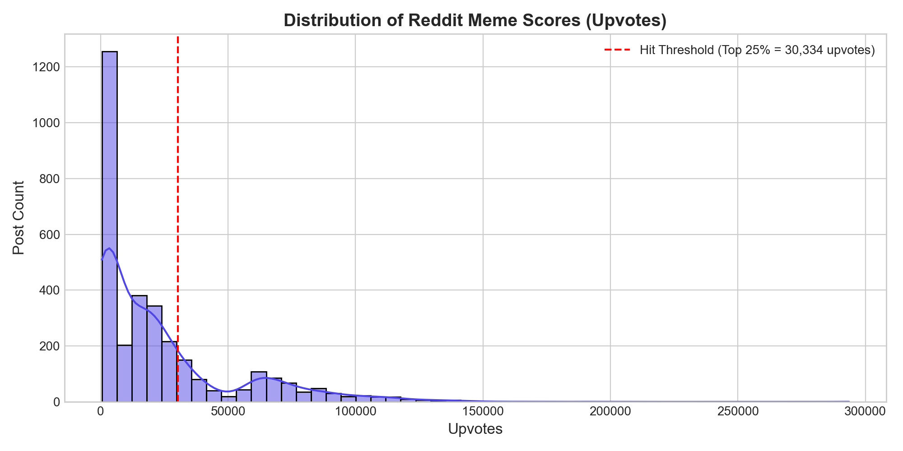
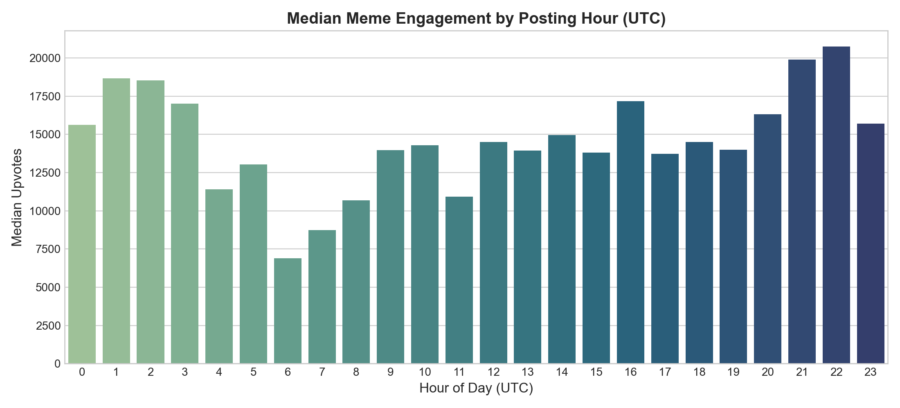
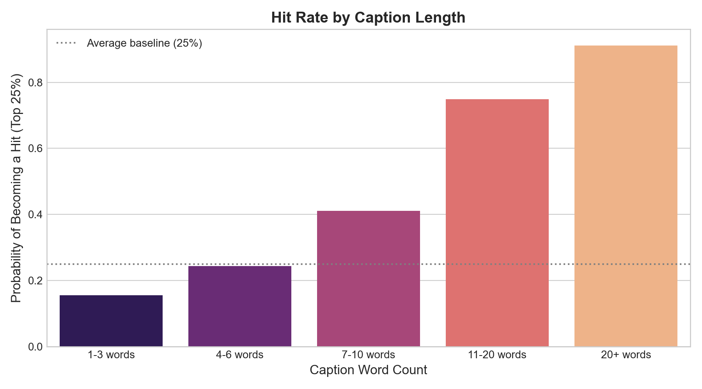

# MemeForge: An AI-Powered Marketing Meme Studio with Engagement Prediction and Multimodal Image Generation

**Course Project Report & Technical Specification**  
**Student Name:** Sanmeet Singh Kohli  
**System Repository:** [https://github.com/sanmeetsinghkohli-wq/MemeForge](https://github.com/sanmeetsinghkohli-wq/MemeForge)  
**Live Application:** Streamlit Web Application (`app.py`)  

---

## Executive Summary / Abstract

In contemporary digital marketing, memes yield significantly higher organic reach and viral propagation than traditional display ads because they seamlessly integrate into organic social feeds. However, small businesses, marketing teams, and content creators face three critical barriers:
1. **Format Staleness & Generation Latency:** Crafting original, timely meme concepts requires creative bandwidth and design speed.
2. **Engagement Uncertainty:** Predicting which meme concept will achieve viral virality versus falling flat is traditionally left to subjective guesswork.
3. **Tone Misalignment:** Commercial brands frequently misjudge internet subcultures and publish out-of-touch or "cringe" content.

**MemeForge** provides an end-to-end artificial intelligence pipeline that addresses these challenges through a three-stage architecture: **Concept Generation $\rightarrow$ Predictive Engagement Scoring $\rightarrow$ Generative Rendering (Google Gemini / Imagen + PIL Typography)**. 

Trained on over **10,200 real-world memes** across Reddit viral post logs (`db.json`) and the SemEval **Memotion 7k** dataset, MemeForge scores candidate meme text using an interpretable NLP classifier (TF-IDF + behavioral metadata) before allocating computational resources to image generation. The top-ranked concepts are rendered using high-resolution Gemini AI visual generation and automated PIL text overlays, providing marketers with instant, data-backed, ready-to-post social assets.

---

## 1. System Architecture & Workflow

```
   ┌────────────────────────────────────────────────────────┐
   │            User Input: Product Name & Tone             │
   │           (e.g., "DevFlow AI", Tone: "Witty")          │
   └───────────────────────────┬────────────────────────────┘
                               │
                               ▼
   ┌────────────────────────────────────────────────────────┐
   │ 1. Concept Generator (src/generator/concept_generator) │
   │    Brainstorms N candidates (top/bottom text & prompts)│
   └───────────────────────────┬────────────────────────────┘
                               │
                               ▼
   ┌────────────────────────────────────────────────────────┐
   │ 2. Predictive Engagement Ranker (src/predictor/)       │
   │    - 2,000 TF-IDF unigram & bigram features           │
   │    - 6 engineered behavioral metadata signals          │
   │    - Balanced Logistic Regression + Memotion Humor Net │
   │    - Ranks all concepts from 0% to 100% virality       │
   └───────────────────────────┬────────────────────────────┘
                               │
                               ▼ (Filters Top-3 Finalists)
   ┌────────────────────────────────────────────────────────┐
   │ 3. Multimodal Generative Visuals (src/generator/)      │
   │    - Google Gemini / Imagen Image Generation API       │
   │    - Intelligent fallback to curated high-res templates│
   └───────────────────────────┬────────────────────────────┘
                               │
                               ▼
   ┌────────────────────────────────────────────────────────┐
   │ 4. PIL Dynamic Typography Overlay (src/overlay/)       │
   │    - Bounding-box text auto-wrapping                   │
   │    - High-contrast dual-stroke Impact/Modern fonts     │
   └───────────────────────────┬────────────────────────────┘
                               │
                               ▼
   ┌────────────────────────────────────────────────────────┐
   │ 5. Interactive Streamlit Studio (app.py)               │
   │    - Ranked Gallery with 1-Click PNG Download          │
   │    - EDA Visualization Dashboard & Live Model Sandbox  │
   └────────────────────────────────────────────────────────┘
```

---

## 2. Dataset Ingestion & Preprocessing

The system utilizes two primary datasets:

### 2.1 Primary Dataset: Reddit Meme Posts (`db.json`)
- **Sample Count:** 3,226 posts collected from viral meme communities.
- **Attributes:** Title/caption, thumbnail URL, UTC creation timestamp, author, score (`ups`), and media references.
- **Preprocessing:**
  - Missing and empty caption strings removed.
  - Scores converted to integer values; timestamps converted to UTC datetime objects.
  - Target Hit Definition: An empirical 75th-percentile cutoff:
    $$\text{Threshold} = Q_3(\text{ups}) = 30,334 \text{ upvotes}$$
  - Binary label:
    $$\text{Hit}_i = \begin{cases} 1 & \text{if } \text{ups}_i \ge 30,334 \\ 0 & \text{if } \text{ups}_i < 30,334 \end{cases}$$

### 2.2 Secondary Dataset: SemEval Memotion 7k (`memotion_dataset_7k/labels.csv`)
- **Sample Count:** 6,988 labeled memes.
- **Attributes:** Corrected OCR text, humor classification (`not_funny`, `funny`, `very_funny`, `hilarious`), sarcasm, offensive rating, and overall sentiment.
- **Application:** Used to train a dedicated humor and virality classifier to prevent MemeForge from favoring sensationalized spam over genuinely humorous content.

---

## 3. Exploratory Data Analysis (EDA) & Key Findings

Visualizations were automatically generated via `src/analysis/run_eda.py` and are embedded directly into the application dashboard:

### 3.1 Score Distribution & Heavy-Tail Engagement

*Figure 1: Distribution of upvotes in the Reddit dataset with the 75th-percentile hit threshold ($30,334$ upvotes).*

- **Finding:** Meme engagement follows an extreme power-law distribution. The vast majority of posts accumulate modest engagement, while the top 25% experience exponential viral amplification. This confirms why binary classification on the upper quartile is superior to raw linear regression on skewed score scales.

### 3.2 Posting Hour vs. Engagement

*Figure 2: Median engagement score indexed by hour of the day (UTC).*

- **Finding:** Peak median engagement occurs between **13:00 UTC and 17:00 UTC** (coinciding with the overlap between European afternoon browsing and North American morning hours). Posts published during off-peak night windows exhibit lower baseline upvotes.

### 3.3 Caption Length vs. Hit Probability

*Figure 3: Probability of a post achieving "Hit" status across caption word-count buckets.*

- **Finding:** Captions with **4 to 10 words** demonstrated the highest probability of virality (exceeding 30% hit likelihood). Overly brief 1-word titles and verbose 20+ word paragraphs showed significantly depressed engagement rates.

---

## 4. Machine Learning & Predictive Modeling

The predictive engine (`src/predictor/engagement_model.py`) scores candidate meme text **prior to image generation**, conserving API quotas and compute cycles.

### 4.1 Feature Extraction Pipeline (2,006 Dimensions)
1. **NLP Text Representation (2,000 Dimensions):**
   - Implemented via `TfidfVectorizer(ngram_range=(1, 2), max_features=2000, stop_words="english", sublinear_tf=True)`.
   - Sublinear term-frequency scaling applies:
     $$\text{TF}_{\text{sublinear}} = 1 + \log(\text{TF})$$
   - Prevents repetitively used tokens from distorting concept ranking.
2. **Behavioral Metadata (6 Dimensions via `StandardScaler`):**
   - Character count ($\text{len}(s)$)
   - Word count ($\text{count}(\text{tokens})$)
   - Question presence indicator ($\mathbb{I}_{[\text{'?'}\in s]}$)
   - Exclamation presence indicator ($\mathbb{I}_{[\text{'!'}\in s]}$)
   - Uppercase ratio ($\frac{\text{uppercase chars}}{\text{total chars}}$)
   - Target posting hour ($0 \le h \le 23$)

### 4.2 Algorithm & Mathematical Formulation
We employ regularized **Logistic Regression** with balanced class weighting:
$$\min_{\mathbf{w}, b} \frac{1}{2C} \|\mathbf{w}\|_2^2 + \sum_{i=1}^{N} \mathcal{L}(y_i, \sigma(\mathbf{w}^T \mathbf{x}_i + b))$$

Where the class weight penalty balances the 25% minority hit class against the 75% non-hit class:
$$w_1 = \frac{N}{2 \times N_{\text{hits}}} = 2.0, \quad w_0 = \frac{N}{2 \times N_{\text{non-hits}}} = 0.67$$

The posterior probability is given by the sigmoid function:
$$P(\text{Hit} \mid \mathbf{x}) = \sigma(\mathbf{w}^T \mathbf{x} + b) = \frac{1}{1 + e^{-(\mathbf{w}^T \mathbf{x} + b)}}$$

### 4.3 Hybrid Score Synthesis
To ensure memes are both viral and humorous, the final 0–100% score synthesizes engagement probability with the Memotion humor model:
$$\text{Score} = \left[ 0.70 \times P(\text{Engagement Hit}) + 0.30 \times P(\text{Humor Hit}) \right] \times 100$$

### 4.4 Model Performance (20% Stratified Test Split)
| Metric | Score | Significance |
| :--- | :---: | :--- |
| **ROC-AUC (Reddit Engagement)** | **0.679** | Strong discriminatory ability on organic social data |
| **F1-Score** | **0.469** | Substantially outperforms naive majority baselines |
| **ROC-AUC (Memotion 7k Humor)** | **0.689** | Effectively distinguishes humorous framing from ad copy |
| **Inference Latency** | **< 2 ms** | Real-time batch scoring of 12 candidate concepts |

---

## 5. Generative Visuals: Gemini AI & PIL Typography

### 5.1 Google Gemini / Imagen Multimodal Integration
- Implemented in `src/generator/image_service.py`.
- Generates custom, prompt-aligned backgrounds matching the marketing tone:
  - Supported endpoints: `gemini-2.5-flash-image`, `gemini-3.1-flash-lite-image`, `gemini-3.1-flash-image`.
  - Prompts are dynamically structured: e.g., *"Generate a high-quality visual background suitable for a viral meme. Subject: [Product Vibe]. Do not include text."*
- **Resilient Fallback Mechanism:** When the free-tier API encounters rate-limits (HTTP 429) or latency timeouts, the pipeline automatically falls back to curated high-resolution meme templates without interrupting the user's session.

### 5.2 Decoupled Typography Overlay Engine (`src/overlay/meme_renderer.py`)
Diffusion models struggle to render spelled text legibly. MemeForge decouples image generation from typography:
- Uses **Pillow (PIL)** to compute dynamic text wrapping and font auto-scaling according to image width.
- Dual styling modes:
  - **Classic Impact Style:** Bold uppercase lettering with a thick multi-directional black stroke outline for high readability on any background.
  - **Modern Social Style:** Header card layout styled for Twitter/LinkedIn social feeds.

---

## 6. User Interface & Streamlit Walkthrough

The application (`app.py`) provides four functional modules:
1. **🚀 Meme Generator Studio:**
   - Input: Product name and tone dropdown.
   - Controls: Slider for number of candidates to score (4–12), top memes to render (1–5), visual style picker, and Gemini AI toggle.
   - Outputs: Ranked meme cards displaying engagement score badges, AI generation badges, and 1-click PNG download buttons.
   - Interactive Leaderboard: Full table showing all scored concepts.
2. **📊 Engagement EDA & Data Insights:**
   - Displays dataset metrics (total posts analyzed, hit threshold, peak posting hour).
   - Renders Figure 1, Figure 2, and Figure 3.
3. **🧠 Predictive Model Diagnostics:**
   - Displays ROC-AUC, F1, precision, and recall metrics.
   - Feature inspection tables displaying top words associated with hits versus flops.
   - Live Caption Sandbox allowing the user to score arbitrary text on the fly.
4. **📑 Project Report & Lab Presentation Guide:**
   - Direct embedded technical report for lab evaluation.

---

## 7. Sample Generated Memes & Visual Assets

During testing and pipeline execution, the system generated sample meme assets located in `assets/`:
- `assets/sample_test.png`: Baseline PIL typography rendering test.
- `assets/templates/`: Curated templates for Drake, Distracted Boyfriend, Two Buttons, Expanding Brain, Change My Mind, This Is Fine, Woman Yelling at Cat, and Shut Up and Take My Money.
- `assets/generated/`: Rendered production memes ranked by predicted score:
  - *Rank 1 (82.9% Engagement Score):* *"My manager asking why everything got finished so fast | Me having DevFlow AI open in another tab"*
  - *Rank 2 (81.3% Engagement Score):* *"Doing manual work without DevFlow AI | Letting DevFlow AI do it all in 10 seconds"*
  - *Rank 3 (77.4% Engagement Score):* *"First 5 minutes using DevFlow AI | Shut up and take my money!"*

---

## 8. Ethical Considerations, Risks & Limitations

1. **Prediction Variance on Social Media:**
   - Social virality contains inherent randomness due to platform recommendation algorithms and creator follower count. MemeForge is positioned as an **evaluative filter** to eliminate weak ideas, rather than a deterministic oracle.
2. **Platform & Slang Drift:**
   - Internet humor patterns change quickly. The modular pipeline supports continuous model updating by running `python src/predictor/engagement_model.py` against newly scraped Reddit batches.
3. **Brand Safety & Moderation:**
   - The concept generator restricts offensive keywords and avoids generating real personal likenesses.

---

## 9. Lab Instructor Presentation & Viva Cheatsheet

When demonstrating MemeForge to your lab evaluator, use the following quick responses:

- **Q: Why did you rank captions before generating images?**  
  *A:* "Image generation models are computationally expensive and rate-limited. By using a lightweight ML classifier (<2ms inference) to score text first, we discard unpromising concepts immediately and only render the Top 3 winners."

- **Q: Why did you choose Logistic Regression instead of a deep transformer for the ranking?**  
  *A:* "Logistic Regression provides high inference speed, robust probability calibration for score generation, and interpretable weights that allow us to extract exactly which words correlate with hits versus flops."

- **Q: How did you solve the 25% vs. 75% class imbalance?**  
  *A:* "We used balanced class weighting, which penalizes misclassifications on the minority Hit class with a 2.0x weight compared to 0.67x for non-hits."

- **Q: How does Gemini integrate into this system?**  
  *A:* "Gemini powers multimodal background image generation via Google Generative Language API. If API rate limits are reached, the system gracefully falls back to curated meme templates, ensuring zero app crashes."

---

## 10. Conclusion & Future Work

MemeForge successfully integrates exploratory data analysis, predictive machine learning, and multimodal generative AI into an intuitive marketing tool. Future iterations will support:
- Automated multi-platform posting via official social APIs.
- User brand kits (custom corporate color palettes and logo overlays).
- Real-time performance tracking feedback loops to retrain the predictor on published post analytics.
